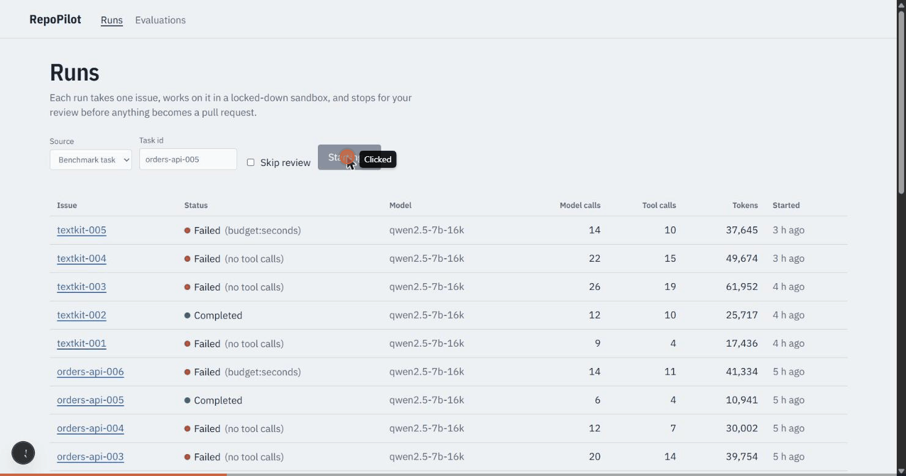
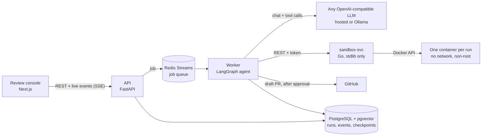
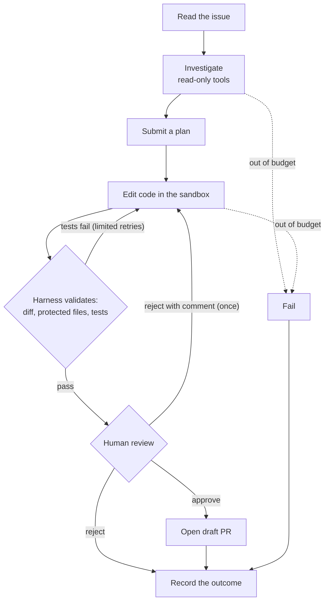

# RepoPilot

An AI software engineering agent that takes an issue, investigates the repository, fixes the
code inside a locked-down sandbox, proves the fix with tests, and opens a draft pull request
**only after a person approves it**. Every step is checkpointed, recorded and measurable.

[](https://github.com/Harip98/repopilot/actions/workflows/ci.yml)




RepoPilot is about **model-directed tool orchestration done safely**. The goal is not to beat
commercial coding agents. It is to show:

- stateful orchestration;
- tools the model cannot misuse;
- recovery from failure;
- evaluation honest enough to argue with.

**At a glance**

- **Evidence.**
  - Automated tests in Python, Go and TypeScript, with CI on every push.
  - A 25-task benchmark graded by hidden tests, with a test split frozen before it was run.
  - Results reported unedited, including the weak ones.
- **Built with.** Python (LangGraph, FastAPI), Go, TypeScript (Next.js), PostgreSQL, Redis,
  Docker and OpenTelemetry.
- **Runs on** any OpenAI-compatible model, hosted or local through Ollama.

## See it work: one real run

This is the run in the GIF above: a live end-to-end check on the local qwen2.5 7B model, on a
laptop. The task is `orders-api-005` from the benchmark.

**The issue**, written the way a user would report it:

> The admin dashboard sends `GET /orders?status=PAID` and gets `"total": 0`, while
> `status=paid` returns plenty of orders. Status values should be matched case-insensitively;
> this used to work.

**What happened:**

| Time | Step | What happened |
|---|---|---|
| 0:00 | Queued | The run was started from the console. A worker picked it up and started a sandbox holding the buggy repository |
| 0:35 | Investigate | Two code searches, with read-only tools |
| 1:08 | Plan | Root cause: *"the status filter in the `list` method of the `OrderStore` class is case-sensitive"*. Files to change: `app/store.py`. This unlocked the editing tools |
| 1:32 | Edit | The model read the file, changed one line with `replace_text`, ran the tests itself, then called `finish` |
| 2:35 | Validate | The harness checked the diff (no protected files touched) and ran the suite: 13 passed. The run paused for review, showing the plan, the diff and the test output |
| 2:46 | Approve | The reviewer approved it in the console |
| 2:48 | Graded | Hidden tests the agent never saw were added and run: **resolved** |

**The fix it proposed:**

```diff
         if status:
             wanted = status
-            orders = [o for o in orders if o.status.value == wanted]
+            orders = [o for o in orders if o.status.value.lower() == wanted.lower()]
```

Two details show why the harness matters:

- **A green suite proved little here.** The visible tests already passed before the change,
  because they don't cover the failing case. The console flags this to the reviewer, and the
  result was decided by the hidden tests.
- **Everything is accounted for.** The run used 7 model calls, 5 tool calls and about 14,000
  tokens. Every call is stored in Postgres and shown on the console's timeline.

A benchmark task has no repository to push to, so this run ended as `completed`. For a GitHub
issue, approval opens a draft pull request.

## What it does

| Step | How |
|---|---|
| Read the issue and the repo | Read-only tools first: `read_file`, `search_code` (ripgrep), `list_dir`, `git_log`, `git_diff`, and optionally a hybrid `find_code` |
| Plan | The model must call `submit_plan` (root cause, files, acceptance criteria) before it gets any editing tools |
| Edit in a sandbox | `replace_text`, `create_file` and `apply_patch`, all run in a per-run container with no network |
| Validate | The harness, not the model, checks the full diff against protected paths and runs the tests, before and after |
| Recover | Test failures go back to the model, within limits on retries, model calls, tool calls, tokens and time |
| Ask for approval | The diff, test output and reasoning are shown. The run waits, durably, for approve, reject, or reject with a comment (one revision) |
| Open a PR | Built on GitHub through the Git Data API as a **draft**. The GitHub token never enters the sandbox |
| Record | Every model call, tool call (with policy denials), status change and trace goes to Postgres and OpenTelemetry |

## Engineering highlights

| Problem | How RepoPilot handles it | Where to look |
|---|---|---|
| A model can claim "done" when it isn't | `finish` only *requests* validation. The harness diffs the workspace against `HEAD` (including deletions, renames and files hidden by `.gitignore`), checks protected paths and runs the tests. It then checks the workspace again, because test code can write files too | [agent/nodes.py](services/agent-svc/src/repopilot/agent/nodes.py) |
| Generated code is untrusted | One Go service, standard library only, authenticated and listening only on the local machine, is the only process that holds the Docker socket. Each run gets a container with no network, a read-only root and dropped privileges | [sandbox-svc](services/sandbox-svc/internal/sandbox/manager.go), [security model](docs/security.md) |
| A model can sneak an edit past a filter | Tools unlock by phase: read-only until a plan is submitted. The write policy asks git itself which paths a patch touches, which closes tricks such as quoted names, renames and binary diffs | [tools/policy.py](services/agent-svc/src/repopilot/tools/policy.py), [tools/builtin.py](services/agent-svc/src/repopilot/tools/builtin.py) |
| Workers crash, and people take time to review | Every graph step is a Postgres checkpoint. Approval is a durable `interrupt()`. Jobs go through Redis Streams consumer groups with lease renewal and reclaim. Two simultaneous approvals cannot both resume a run | [agent/graph.py](services/agent-svc/src/repopilot/agent/graph.py), [queue.py](services/agent-svc/src/repopilot/queue.py), [worker.py](services/agent-svc/src/repopilot/worker.py) |
| Agent demos are easy to cherry-pick | The benchmark has 25 tasks:<ul><li>hidden tests</li><li>issues written as symptoms</li><li>no fix hidden in `.git`</li><li>scoring that a planted `conftest.py` cannot fool</li><li>a test split frozen by hashes</li><li>95% confidence intervals</li></ul> | [eval/](services/agent-svc/src/repopilot/eval/), [evaluation](docs/evaluation.md) |
| You can't fix what you can't see | Run timelines in Postgres, streamed live to the console over SSE. OpenTelemetry spans use the GenAI conventions and go to Jaeger or Langfuse | [telemetry.py](services/agent-svc/src/repopilot/telemetry.py), [web/](web/) |

## Results

The benchmark has 25 tasks across three small fixture repositories: 15 for development and 10 for
testing. The test split was frozen before it was run, then run once per model.

| Run | Model | Resolved (hidden tests pass) | 95% CI |
|---|---|---|---|
| dev, before tuning | qwen2.5 7B, local | 4 / 15 (27%) | 11–52% |
| dev, after tuning | qwen2.5 7B, local | 5 / 15 (33%) | 15–58% |
| **test (frozen)** | qwen2.5 7B, local | **1 / 10 (10%)** | 2–40% |
| test, baseline | qwen2.5 3B, local | 0 / 10 (0%) | 0–28% |

**What the numbers say.** The safety harness held completely. Across all 50 runs there were 0
harness errors, 0 attempts to modify protected files and 0 edits to existing tests. The limit
is the model: a 7B model on a 4 GB laptop GPU often emits malformed tool calls, or runs out of
budget while exploring. When it did produce a validated fix, the hidden tests confirmed it 10
times out of 13. Trying a hosted model is a configuration change, not a code change.

The numbers are kept exactly as measured, at git `5179422`. A later audit fixed a bug in the
tool gate that cost some of those runs a step, so a re-run will be reported as a new row, not in
place of these.

Full reports, caveats and how to reproduce them are in [docs/evaluation.md](docs/evaluation.md)
and [eval/reports/](eval/reports/).

## Architecture



- **Console → API.** You start runs and review them in the console. The console talks to the
  FastAPI service through a server-side proxy that holds the API token, so the browser never
  sees it.
- **API → queue → worker.** The API saves each run and puts a job on a Redis Stream. Workers
  take jobs from the stream. A job whose worker dies is picked up by another worker, which
  continues from the run's last checkpoint.
- **Worker → model.** The worker runs the agent and talks to the model through any
  OpenAI-compatible API, hosted or local.
- **Worker → sandbox-svc → container.** Every file read, edit and test run goes through
  sandbox-svc, the only process allowed to create and drive containers.
- **Postgres.** Postgres holds everything durable: runs, their event timelines, every tool
  call, evaluation results and the agent's checkpoints.

The agent itself is a state machine. Each step is checkpointed, so a run can stop at any point
and continue later:



Budgets cover model calls, tool calls, tokens and wall-clock time. They are checked before every
model call and every tool call, so one reply asking for 60 tool calls cannot overshoot them.
Time spent waiting for the reviewer is not counted. The exact graph, persistence, queue
semantics and GitHub flow are in [docs/architecture.md](docs/architecture.md).

## Tech stack

| Area | Technology |
|---|---|
| Agent | Python 3.12, LangGraph with a Postgres checkpointer, Pydantic, structured tool calling over any OpenAI-compatible API |
| Sandbox | Go 1.27 (standard library only), Docker Engine API, hardened containers |
| Service | FastAPI, Server-Sent Events, Redis Streams (consumer groups, reclaim), psycopg 3 |
| Data | PostgreSQL 16 with pgvector: runs, events, evals, checkpoints, and optional hybrid code search (vector + full-text, RRF) |
| Interfaces | Next.js 15 review console, a CLI, and an MCP server that exposes the sandboxed tools |
| Observability | OpenTelemetry with GenAI semantic conventions, exported to Jaeger or Langfuse |
| Quality | pytest, Go tests with the race detector, ESLint, GitHub Actions, Dependabot |
| Delivery | Docker Compose, AWS deployment notes and a user-data script |

## Try it

You need Docker, [uv](https://docs.astral.sh/uv/), Node 22, and either an API key for an
OpenAI-compatible model or [Ollama](https://ollama.com).

```bash
cp .env.example .env                  # point REPOPILOT_LLM_* at your model
docker compose up -d                  # Postgres, Redis, sandbox-svc
cd services/agent-svc
uv sync
uv run repopilot migrate
uv run repopilot bench build-images   # sandbox images for the benchmark repos
uv run repopilot solve --task orders-api-005
uv run repopilot approve <run-id>     # or: --reject --comment "use casefold"
```

To use the review console instead of the terminal:

```bash
uv run repopilot eval import          # loads the shipped results for the Evaluations page
uv run repopilot serve                # API on 127.0.0.1:8000
uv run repopilot worker               # runs queued jobs
cd ../../web && npm ci && npm run dev # console on http://127.0.0.1:3000
```

Local models, GitHub issues, evaluation runs and deployment are covered in
[docs/running.md](docs/running.md).

## Tests

| Suite | Command (from `services/agent-svc` unless noted) | Needs |
|---|---|---|
| Unit | `uv run pytest` | nothing (fakes, no network) |
| Integration | `uv run pytest -m integration` | Postgres, Redis |
| Sandbox | `uv run pytest -m sandbox` | sandbox-svc and Docker |
| Go | `go test ./...` in `services/sandbox-svc` | nothing |
| Web | `npm run lint && npm test && npm run build` in `web/` | nothing |

CI runs all of them on every push.

## Repository tour

```
services/agent-svc    Python: agent graph, tools, benchmark, evaluation, API, worker, CLI, MCP server
services/sandbox-svc  Go: the hardened sandbox service
web/                  Next.js review console
bench/                fixture repositories, 25 tasks with hidden tests, sandbox images
db/migrations/        numbered SQL migrations
eval/reports/         every evaluation run: per-task JSONL, Markdown report, metadata
deploy/               AWS user data, Ollama Modelfiles for the local models
docs/                 architecture, security, evaluation, running, AWS deployment, design history
```

## Limits and next steps

- **Small fixtures.** The benchmark repositories are small, and every reference fix is one
  change in one file. Real repositories are harder.
- **Shared kernel.** Containers share the host kernel. For untrusted public use, the next step
  is a sandboxed runtime such as gVisor or Firecracker, set where sandbox-svc creates the
  container.
- **Small local model.** The reported numbers come from a 7B model on a laptop GPU. A hosted
  model is the obvious next evaluation run.
- **Baked dependencies.** GitHub runs have no network inside the sandbox, so a repository's
  dependencies must be baked into a sandbox image.

## License

[MIT](LICENSE)
